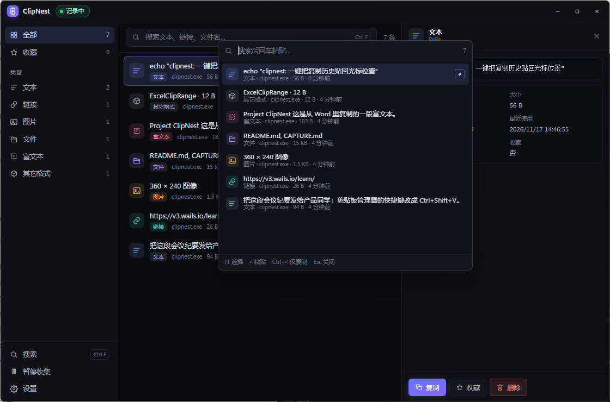
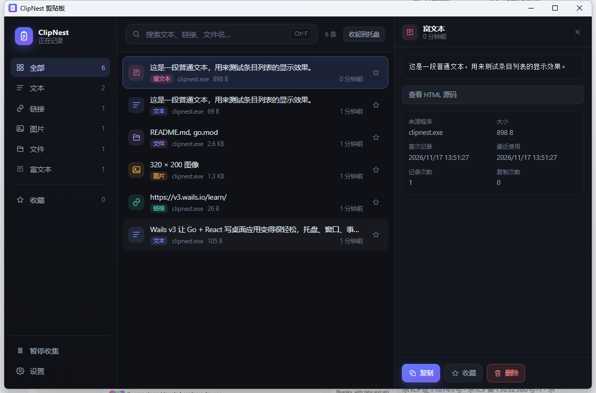
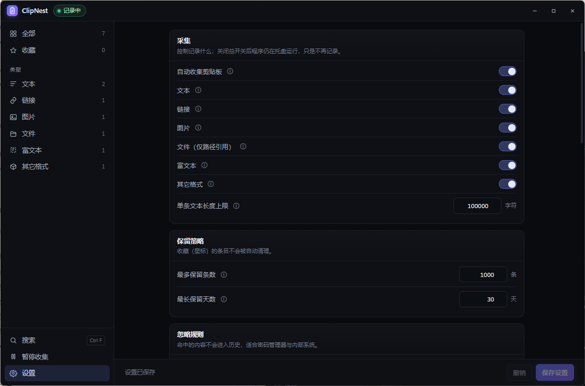

# ClipNest

[](https://github.com/bbqisbbq/clipnest/releases) [](https://github.com/bbqisbbq/clipnest/releases/latest) [](LICENSE)

> 常驻托盘的 Windows 剪贴板管理器 · [Wails v3](https://v3.wails.io) + Go + React + TypeScript

ClipNest 在你使用电脑时安静地记录进入过系统剪贴板的一切——文本、链接、图片、富文本、文件（只记引用），
连 Excel 区间、颜色、音频这类私有格式也原样留底。按一次快捷键，列表就在**光标旁边**弹出来，
方向键或鼠标选中，回车直接粘到当前位置；需要跨机器时，用你自己的 WebDAV 目录同步。

界面是无边框的：标题栏、按钮、面板都由应用自己绘制，和内容同一套配色与圆角。



片段也一样触手可及：弹窗里输入 `--` 直接搜索短语库。


## 特性

- **光标处快速粘贴**：`Ctrl+Shift+V` 在文本光标旁弹出列表，`↑↓` 选择、`Enter` 直接粘贴进
  当前程序、`Ctrl+Enter` 只复制不粘贴、`Esc` 关掉并把焦点还回去；每行末尾还能直接
  **置顶 / 归档 / 删除**，整理历史不用打开主窗口。
- **托盘常驻**：关闭窗口只是隐藏窗口，进程继续监听；只有托盘菜单的「退出 ClipNest」才真正退出。
- **静默收集**：基于 Win32 `AddClipboardFormatListener` + `WM_CLIPBOARDUPDATE`，不做轮询、几乎零开销。
- **多格式，且不漏**：文本、链接、图片（`PNG`/`CF_DIB`/`CF_DIBV5`）、富文本（`HTML Format` / RTF）、
  文件（`CF_HDROP`）、OLE 延迟渲染的剪贴板，最后还有「其它格式」兜底（原样保存私有格式字节，
  可原样粘回）。覆盖细节见 [docs/CAPTURE.md](docs/CAPTURE.md)。
- **WebDAV 跨机器同步（打包传输）**：远端 `clipnest_data/` 里**一台机器一个 zip 包**（`<设备id>-<主机名>.zip`），
  包内是整份历史 + 附件 + 删除墓碑 + 设置。同步 = 读所有别人的包（并集合并）+ 写自己那一个包，
  请求数与条目数量无关；**每台机器只写自己的文件，写冲突不可能发生**。默认 30 分钟一次，
  内容没变化时连上传都跳过。设计与竞态分析见 [docs/SYNC.md](docs/SYNC.md)。
- **主题**：4 套配色预设（默认深色 / 亮白 / 纸感 / 墨黑）+ 跟随系统 + 自定义 CSS（自动去除 @import 与远程 url）+ 对比度自检（WCAG AA）。全部走设计 token。
- **两级导航**：左侧是「内容」筛选器（全部 / 我写的 / 剪贴板 / 片段 / 图片 / 置顶 / 已归档，可双击改名换图标）
  加一个月历；右侧是同一条时间线，所有内容都在这里，靠属性区分来源。
- **快捷键记一笔**：`Ctrl+Shift+N` 在光标处弹出小编辑框（Enter 保存 / Esc 关闭），不打断手上的事。
- **统一条目视图（Memos 形态）**：整页上下结构 —— 上面时间线，下面固定输入框（可拖高）；
  编辑器统一用 **Vditor（IR 即时渲染）**：完整工具栏、图文混排、表格/任务列表/代码块开箱即用，
  贴图自动存成附件。正文里写 `#标签` 自动归类、可置顶/归档、中文子串搜索（SQLite FTS5 trigram）；
  没有用户、分享、评论，也没有服务端。
  > 注意：IR 模式保存时会按 Markdown 规范整理一次格式（表格对齐、`[x]` 大写），这是引擎行为，
  > 幂等且不影响同步配对；设计取舍见 [docs/design/2026-11-19-todo-filters-editor.md](docs/design/2026-11-19-todo-filters-editor.md)。
- **工具栏可自己配**：设置 → 编辑器工具栏，详情视图与底部输入框分别挑按钮（含分隔线），不用的一律可以关掉。
- **条目详情**：双击卡片在**右侧整区**打开（不是弹窗），顶部面包屑返回、`⌘S` 保存、`Esc` 返回，
  右栏是能力/片段/元信息面板；返回时列表的滚动位置不动。
- **待办收集**：在任何条目里写 `- [ ] 一件事`，它就会出现在侧栏「待办」页里（跨条目聚合，
  未完成在前、已完成折叠）。勾选直接改写那行正文的 `[ ]`/`[x]`，点文字跳到它所在的条目。
  完成状态是条目的派生属性（`todo_state`），不往正文塞 tag。
- **自定义筛选器**：`＋ 新建筛选器` 用规则拼条件——标签 / 待办 / 来源 / 类型 / 能力 / 关键词 /
  天数 / 某一天 / 置顶 / 已归档，支持 `满足全部 / 满足任一 / 都不是` 与一层子组组合；
  弹窗里实时显示「命中 N 条」。内置筛选器只有「置顶」可删，「全部内容」等保留为系统维度。
- **片段库（短语）**：把常用回复、地址、提示词、图片、文件、网址、程序、命令存成片段，
  配一个缩写（如 `addr-`）；弹窗里输入 `--` 搜索片段，回车按类型执行（粘贴 / 打开 / 启动 / 执行）。
  详见 [docs/SNIPPETS.md](docs/SNIPPETS.md)。
- **缩写自动展开**：打开后在任何输入框键入 `addr` 再按空格就替换成内容（空格、回车、标点都能收尾，也可继续用 `addr-`）——和 eTool / PhraseExpress / AutoHotkey 的
  打字触发一致（默认关闭，属于全局键盘钩子）。
- **本地数据库**：历史和图片存在一个 SQLite 文件里（`clipnest.db`），搜索走索引、写入事务化，
  备份就是复制一个文件。
- **自动更新**：启动后检查 GitHub Releases，发现新版本在窗口顶部提示，一键下载并静默安装。
- **自带字体**：界面正文用 Inter（拉丁）+ Noto Sans SC（中文）做比例排版，代码块、编辑器、
  快捷键框用 [Maple Mono Normal NF CN](https://github.com/subframe7536/maple-font)（SIL OFL 1.1，等宽）；
  不再依赖系统「微软雅黑」，125%/150% 缩放下也不发虚。
- **去重**：按内容哈希去重，重复复制只更新时间戳与次数，不产生垃圾条目。
- **置顶 / 搜索 / 归类**：全部、我写的、剪贴板、片段、图片、置顶、已归档（筛选器可保存、可自定义）；
  搜索匹配正文、文件名与来源程序。
- **一键回填**：点「复制」或双击条目，把内容重新写回剪贴板，并抑制自己写入产生的回声记录。
- **单条长度上限**：超过设定字符数的文本会被跳过（0 = 不限制）。**历史不会自动清理**——不删就一直在。
- **隐私**：可整体暂停收集；程序不按来源程序过滤，密码管理器复制出来的内容请手动删除。
- **其它**：开机自启（写 HKCU Run）、单实例（第二次启动只是把窗口拉到前台）、诊断日志。
- **纯本地优先**：不联网（除非你配置了 WebDAV），数据全部存在 `%APPDATA%\ClipNest`。

## 文件复制怎么处理？—— 四种方案与当前选择

文件类复制（`CF_HDROP`）有四种典型做法，ClipNest 采取 **方案 A+B**：

| 方案 | 做法 | 优点 | 代价 |
| --- | --- | --- | --- |
| **A+B（当前实现）** | 只记录文件路径与元信息，周期性/手动检查是否还存在，失效则标记「已失效」 | 零磁盘占用、不碰用户原文件、隐私风险最低 | 原文件被移动/删除后引用失效，无法「恢复」内容 |
| C 归档实体 | 把文件拷进库目录 | 原文件删了也能取回 | 吃磁盘（需配额策略），隐私与备份风险高 |
| D 忽略文件 | 完全不记录 | 最简单 | 少一类能力 |
| E A+B + 一键归档 | 平时存引用，需要长期保留时手动「归档到库」 | 兼顾成本与可靠性 | 需要多一套归档目录与配额逻辑 |

> 详细取舍、数据模型与后续可选实现见 [docs/FILE-STRATEGY.md](docs/FILE-STRATEGY.md)。
> 当前版本实现的是 A+B；E 的「一键归档」已预留在数据模型里（`Entry.Files` 与 `entry_blobs` 附件存储）。

## 安装

只发一个安装包：**全用户安装**（写到 `C:\Program Files\bbqisbbq\ClipNest`，需要管理员权限，
向导里可以改目录）。从 2.4.0 起不再提供免 UAC 的 per-user 版本。

| 文件 | 安装到 | 权限 |
| --- | --- | --- |
| `clipnest-<版本>-amd64-setup.exe` | `C:\Program Files\bbqisbbq\ClipNest` | 需要管理员（UAC） |

GitHub Releases 上只保留**最新一个版本**的安装包（旧版本资产会随每次发版清理掉）。

安装包**未做 Authenticode 签名**，首次运行会触发 SmartScreen 提示（「更多信息 → 仍要运行」）。
要签名的话脚本是现成的（自签名证书在 `build\signing\`，不入库）：

```powershell
# 自签名（默认，无需付费证书）；签名后发布者显示 ClipNest (self-signed)
powershell -File scripts\sign.ps1 -Path "bin\clipnest-2.4.0-amd64-setup.exe,bin\clipnest.exe" -SelfSigned

# 正式证书（买了 OV/EV 证书后；带时间戳才能长期有效）
$env:CLIPNEST_SIGN_PFX="D:\certs\clipnest.pfx"; $env:CLIPNEST_SIGN_PASSWORD="***"
powershell -File scripts\sign.ps1 -Path "bin\*.exe" -Timestamp http://timestamp.digicert.com
```

自签名不会自动消除"无法验证发布者"提示，但有两个实际好处：文件被篡改会被立刻发现，并且把
`build\signing\clipnest-selfsigned.cer` 导入「受信任的根证书颁发机构 + 受信任的发布者」后不再报警。

安装向导（简体中文）会问三件事：

1. **安装位置**
2. **是否「开机自动启动」**（默认勾选）——写当前用户的 `HKCU\...\Run`，命令是
   `"<安装目录>\clipnest.exe" --background`，登录后静默驻留托盘、不弹窗。
   之后随时可以在托盘菜单或设置页的「开机自动启动」关掉，两边状态是同步的。
3. 装完勾选「立即启动」。

装好后可以完全不管更新：程序会自己检查 GitHub Releases 并在窗口顶部提示；
也可以在「设置 → 更新」里手动检查，或点托盘菜单的「检查更新…」。

其它行为：

- 缺少 WebView2 运行时会自动安装（安装包里内置 bootstrapper 才会联网下载）。
- 卸载在「设置 → 应用 → 已安装的应用」里；**会先询问是否删除剪贴板历史**（默认保留），
  静默卸载 `/S` 总是保留数据。卸载同时会清掉开机启动项、桌面与开始菜单快捷方式。
- 安装包未做代码签名，首次运行可能触发 SmartScreen 提示（「更多信息 → 仍要运行」）。

打包命令：

```powershell
wails3 task windows:package             # 全用户安装包（发布用的就这一个）
# 产物：bin\clipnest-amd64-installer.exe（改名为 clipnest-<版本>-amd64-setup.exe 再上传）

# 本地自用想免 UAC 时可以打 per-user 包，但不随发布分发
wails3 task windows:package INSTALL_SCOPE=user
```

> 安装脚本在 `build/windows/nsis/project.nsi`（UTF-8 **带 BOM**，NSIS 要求），
> 可自定义欢迎页、组件页、卸载时是否保留数据、签名命令等。

## 快速开始

### 依赖

| 依赖 | 版本 | 说明 |
| --- | --- | --- |
| Go | 1.26+ | `go.mod` 声明 `go 1.26.0`，低版本会自动尝试下载工具链 |
| Node.js | 20+ | 构建前端（Vite 8） |
| Wails v3 CLI | `v3.0.0` | `go install github.com/wailsapp/wails/v3/cmd/wails3@latest` |
| WebView2 Runtime | 任意新版本 | Windows 10/11 一般已内置 |

### 构建与运行

```powershell
# 依赖（首次）
npm install --prefix frontend

# 开发模式（前端热更新 + Go 自动重启）
wails3 dev

# 生产构建，产物在 bin/clipnest.exe
wails3 build

# 运行已构建的程序（--show 强制打开窗口）
.\bin\clipnest.exe --show
```

### 改完代码怎么自检

```powershell
go build -o bin\clipnest-dev.exe .                  # 后端 + 内嵌前端产物
go test ./internal/...                              # 存储/查询/同步/展开引擎
cd frontend; npx tsc --noEmit; npx vite build --mode production
pwsh -File scripts\visual-check\check-css.ps1       # 改了 CSS 就跑一次，看折叠/卡片还正常
```

改了 Go 的导出面（`ClipService` 的方法、模型字段）要重新生成绑定：
`wails3 generate bindings -clean=true -ts -i`，并确认 `git diff frontend/bindings` 只有预期的改动。

### 打包安装程序（可选）

```powershell
wails3 task common:update:build-assets   # 改了 config.yml 里的版本号后先跑这个
wails3 task windows:package             # NSIS 全用户安装包（需要 NSIS，模板已内置配置）
# 产物 bin\clipnest-amd64-installer.exe，发布前改名为 clipnest-<版本>-amd64-setup.exe
```

### 发版清单

1. 改版本号：`internal/clip/service.go` 的 `Version` 与 `build/config.yml` 的 `info.version` 保持一致；
2. `wails3 task common:update:build-assets`（同步 `build/**/Info.plist`、`windows/info.json`、`wails_tools.nsh` 等资产）；
3. `wails3 task windows:package` → `bin\clipnest-amd64-installer.exe`，改名成 `clipnest-<版本>-amd64-setup.exe`
   （**只发全用户安装包**，不带 per-user 版本）；
4. 提交 + 打 tag：`git tag -a v<版本> -m "ClipNest <版本>"`，然后 `git push origin main --tags`；
5. 建 GitHub Release 并上传上面那一个安装包；**只保留最新版本的安装包**，旧 release 每次发版都清掉。

## 使用

### 快速粘贴（日常主力）

在任意输入框里按 `Ctrl+Shift+V`：列表弹在光标旁边，键盘或鼠标都行。

| 按键 / 操作 | 效果 |
| --- | --- |
| `↑` `↓`（或 `Ctrl+P` / `Ctrl+N`） | 移动选择 |
| 直接输入 | 过滤条目（匹配正文、文件名、来源程序） |
| `Enter` / 单击 | 写入剪贴板并**自动粘贴**到刚才那个窗口 |
| `Ctrl+Enter` | 只写入剪贴板，不自动粘贴 |
| `Esc` | 关闭并把焦点还给原窗口 |
| 行尾三个按钮 / `Alt+P` `Alt+A` `Ctrl+Del` | 置顶 / 归档 / 删除（只动 ClipNest 数据，**不会粘贴**） |

弹窗位置：优先贴住文本框的光标（`GetGUIThreadInfo` 的 `rcCaret`），没有光标（资源管理器、
部分游戏）就用鼠标位置；靠近屏幕边缘时会自动翻转/夹到工作区内。

### 管理窗口



| 操作 | 方式 |
| --- | --- |
| 打开管理窗口 | 托盘图标左键 / 托盘菜单「显示管理窗口」 |
| 收起到托盘 | 标题栏右上 ×（等于最小化到托盘，不是退出） |
| 最小化 / 最大化 | 标题栏右上按钮，或双击标题栏空白处 |
| 上下选择 / 复制 / 删除 / 搜索 | `↑` `↓` / `Enter`、双击 / `Delete` / `Ctrl+F` |
| 彻底退出 | 托盘菜单 →「退出 ClipNest」，或设置页底部「退出 ClipNest」 |

### 设置页



每个开关/输入框右侧的 <kbd>ⓘ</kbd> 是说明：悬停即可看，点击可固定住（键盘 `Tab` + `Enter` 也行）。
底部固定操作条显示「有未保存的修改 / 设置已保存」，可以撤销。

## 数据与存储

```
%APPDATA%\ClipNest\
  clipnest.db     # SQLite 数据库：条目 + 全文索引 + 图片/私有格式的 BLOB（WAL 模式）
  memo_files\     # 超过 512 KB 的附件落盘（库里只留内容寻址的元数据）
  settings.json   # 采集/快捷键/同步/更新/外观等设置
  clipnest.log    # 诊断日志（启动、同步、弹窗定位、前端异常、更新）
```

- **SQLite 单文件**（`modernc.org/sqlite`，纯 Go 驱动，无需 cgo）：条目表 + BLOB 表，搜索走索引，
  写入是事务性的，进程被强杀也不会留下写坏一半的索引；备份 = 复制一个文件。
- 表结构见 `internal/clip/entry_store.go` 的 `schemaSQL`；单条记录见 `entry.go` 的 `Entry`。
- 小附件（≤512 KB）存在 BLOB 表里，大的落盘 `memo_files\`，正文统一用 `memoimg:<hash>` 引用。
- **不自动清理**：没有最大条数、也没有保留天数，条目只在你手动删除/归档时消失。

## 目录结构

```
internal/clip/
  model.go                    Kind / FileRef / Captured 等纯数据
  settings.go                 设置结构与默认值（含 WebDAV、主题字段）
  entry.go                    Entry 类型、采集入库、生命周期
  entry_store.go              entries 表 schema、读写、FTS、mergeEntry
  entry_query.go              EntryQuery 查询（筛选器/日历/统计/标签/缩写检索）
  entry_blob.go               附件字节存取（≤512KB 进库，更大的落盘）
  entry_image.go              纯函数：解码、缩略、MIME 推断
  store.go                    SQLite 打开/迁移、meta、墓碑、统计、诊断日志
  service.go                  ClipService 装配与生命周期
  service_capture.go          采集管线 + 快速输入窗
  service_paste.go            条目 → 剪贴板 / 打开 / picker 弹窗
  service_settings.go         设置保存与副作用（自启、展开器、后台循环）
  entry_api.go                绑定给前端的条目 API 与筛选器 CRUD
  snippet*.go                 片段：条目适配、动作、缩写主机、模板变量
  sync.go / sync_dav.go       同步门面 + WebDAV 传输层
  sync_package.go / sync_run.go / sync_merge.go   包格式 / 一次同步的编排 / 合并规则
  clipboard_windows.go        读剪贴板：格式归类与各类型 capture
  clipboard_formats_windows.go  格式知识与文本提取（跳过清单、URL/RTF/HTML）
  clipboard_write_windows.go  写回：文本 / HTML / RTF / 图片 / CF_HDROP
  dib_windows.go              CF_DIB(V5) ↔ image.NRGBA
  ole_windows.go              OLE IDataObject 回退（延迟渲染）
  watcher_windows.go          消息窗口 + WM_CLIPBOARDUPDATE 监听
  picker_windows.go           光标定位、前台接管、合成 Ctrl+V
  win32_windows.go            Win32 基元：剪贴板 API、前景程序、开机自启
  shell_windows.go            ShellExecute / 资源管理器定位
  platform_other.go           非 Windows 桩实现（保持可编译）
内部按职责分文件的完整表格见 docs/ARCHITECTURE.md
frontend/                     React + TS + Vite
  src/App.tsx                 管理窗薄壳：装 hooks、切视图、转发通知
  src/Picker.tsx              快速粘贴弹窗（`?mode=picker`）；src/Capture.tsx 是快速输入窗
  src/hooks/                  useAppData / useEntries / useEntryImages / useTheme / useToast
  src/components/
    TitleBar / Sidebar / Calendar / Tip / Icons     布局与小组件
    EntriesView + entries/EntryCard                 统一内容视图与卡片
    SettingsView + settings/*                       设置页编排者与七个分区
    EntryEditor / Composer / MarkdownEditor / SnippetFields / HotkeyInput / Lightbox
  src/lib/                    api（绑定封装）、themes（配色预设与对比度自检）、images、format、window
  src/styles/                 按域拆开的样式（base/layout/entries/controls/settings/picker/snippets/timeline/editor/detail/todo/filter/vditor-theme）
  src/theme-light.css         主题引擎管不到的浅色补丁
  bindings/                   wails3 生成的 TS 绑定（改了 Go 导出面要重新生成）
scripts/make_icon.py          生成 appicon.png 与 windows/icon.ico
scripts/visual-check/         样式回归：把构建产物 CSS 内联进标本页并截图（改动 CSS 后跑）
scratch/clipdump/             开发期剪贴板格式转储工具
scratch/setclip/              开发期投放 RTF / 自定义格式到剪贴板的工具
scratch/dav/                  一次性 WebDAV 服务器（同步联调）
scratch/e2e-picker*.ps1       弹窗端到端自动化（回车粘贴 / Esc / Ctrl+Enter）
scratch/cap.ps1               窗口截图助手（定位、悬停、滚轮、点击）
docs/ARCHITECTURE.md          分层、文件职责表、扩展点与"怎么验证"
docs/CAPTURE.md               收集机制、格式覆盖矩阵与已知缺口
docs/SYNC.md                  WebDAV 同步配置、合并规则与限制
docs/SNIPPETS.md              片段库/缩写触发/触发选项/同步行为
docs/FILE-STRATEGY.md         文件复制的方案对比与数据模型
docs/design/                  历史设计记录（Memos 集成、统一条目模型、触发引擎评估）
```

## 排查：开机启动弹出一个黑框

如果登录后看到一个黑色命令行窗口、关掉它 ClipNest 就退出了，说明**开机启动项指向了一个控制台版本的可执行文件**
（调试构建、或者被误写的路径）。自查与修复：

1. 看现在指向哪里

   ``powershell
   (Get-ItemProperty 'HKCU:\Software\Microsoft\Windows\CurrentVersion\Run').ClipNest
   ``

   正常应当是 "C:\Program Files\bbqisbbq\ClipNest\clipnest.exe" --background，
   而这个 exe 是 GUI 子系统（不带控制台）。

2. 让 ClipNest 自己修：用**正确安装的那份**启动一次，它会把启动项重写成自己的路径
   （日志里有 utostart registered (points at another build): …）。

3. 或者在托盘菜单里把「开机自动启动」关掉再打开。

0.8.1 起额外做了三层防护：

- 程序启动时如果检测到自己带着控制台窗口（调试构建），会立刻 FreeConsole() 脱离——
  不再显示黑框，也就不存在"关掉窗口把程序关掉"这回事（调试时可用 CLIPNEST_KEEP_CONSOLE=1 保留）
- 开机启动项指向**已不存在的路径**时不再"沿用"，而是按设置修复或删除
- 联调/测试可以通过 CLIPNEST_RUN_KEY 指向一个临时注册表子键，绝不碰真实的登录启动项
## 已知限制

- **只在 Windows 上有意义**：监听、DIB 解码、光标定位、托盘均为 Win32 实现；其它平台编译出的是空壳。
- **权限不对等**：如果目标程序以管理员身份运行，而 ClipNest 是普通权限，Windows 的 UIPI 会拦住合成的
  `Ctrl+V`（内容仍在剪贴板里，手动粘贴即可）。需要粘贴进提权窗口时，请以管理员身份运行 ClipNest。
- **富文本回填**：写回时同时写 `HTML Format`/RTF 与纯文本，个别老旧应用可能只取纯文本。
- **OLE 延迟渲染**：已做 `IDataObject` 回退（文件、文本），图片仍依赖原生 `PNG`/`DIB`。
- **GDI 图片格式**：只认 `CF_DIB`/`CF_DIBV5`/`PNG`，用 `CF_BITMAP` 句柄传图的程序需要 `GetDIBits`（未实现）。
- **自定义格式上限 1 MiB**：超出的私有格式会被跳过，避免撑爆历史。
- **不做跨屏 DPI 特调**：窗口按系统 DPI 缩放，多屏不同缩放下位置由 Wails/WebView2 决定。
- **删除靠墓碑传播**：删除标记保留 180 天；超出期限或离线太久的机器可能仍留有旧条目（见 [docs/SYNC.md](docs/SYNC.md)）。
- **更新需要联网**：GitHub Releases 检查在无网络或 API 限流时会失败，日志里有原始原因，不影响其它功能。

## 隐私

- 所有数据只写本机 `%APPDATA%\ClipNest`；不开启同步、不检查更新时，程序不发起任何网络请求。
- 密码管理器（`keepass.exe`、`1password.exe`…）复制出来的内容请手动删除：**程序不做自动清理，也不按来源程序过滤**，
  这是 2.1.0 起的产品选择（「以保留为主，手动删除」）。
- 剪贴板本身是全局可读的，ClipNest 只写自己那部分数据，不修改系统设置。

## 路线图

- [ ] 方案 E：条目「归档到库」按钮 + 归档目录配额
- [x] 同步：删除墓碑（tombstone，0.3.0）
- [x] 同步：打包传输——每台机器一个 zip 包，写冲突不可能发生（0.4.0）
- [x] 同步面板：每台设备的包大小/最后更新/本轮拉取明细（0.5.0）
- [ ] 同步增强：字段级冲突合并、可选 DPAPI 加密密码
- [x] 弹窗：图片缩略图 + 数字键 1–9 直选（0.5.0）
- [x] 弹窗：行内置顶 / 归档 / 删除（2.4.0）
- [x] 时间线：卡片收成固定阅读列、操作按钮悬停才出现、双击直接编辑（2.4.0）
- [x] 片段：变量占位符（{{date}} / {{clipboard}} / {{cursor}}）、Markdown 预览、从历史存为片段（0.7.0）
- [ ] 分类规则（按来源程序自动打标签）
- [ ] 条目内图片压缩 / 缩略图缓存，降低 blob 体积


## 许可

MIT，见 [LICENSE](LICENSE)。没有附加条款：拿去用、改、商用、闭源分发都行，保留版权声明即可。
