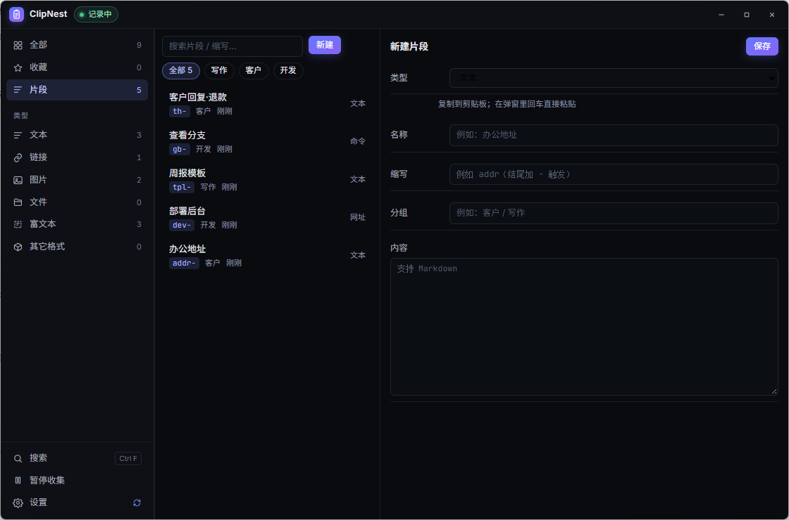

# 片段（短语库）

ClipNest 有两层内容：

| | 剪贴板历史 | 片段 |
| --- | --- | --- |
| 来源 | 自动采集（你复制什么就记什么） | 手写（你决定存什么） |
| 生命周期 | 按保留策略滚动淘汰 | 长期保留，直到你删除 |
| 用途 | 找回刚才复制过的东西 | 反复使用的回复、地址、提示词、命令 |
| 触发方式 | `Ctrl+Shift+V` → 搜索 | `--` 搜索，或在任意输入框敲**缩写** |



## 一、七种类型，各有各的动作

| 类型 | Enter 做什么 | 说明 |
| --- | --- | --- |
| 文本 | 粘贴到光标处 | 支持 Markdown |
| 密码 | 粘贴到光标处 | 列表里掩码显示；**仍会同步**（私有 WebDAV 场景） |
| 图片 | 粘贴图片 | 从剪贴板抓一张即可 |
| 文件 | 复制文件到剪贴板 | 一行一个路径；**单个目录**则是「打开这个文件夹」 |
| 网址 | 用默认浏览器打开 | `Ctrl+Enter` 改为只复制链接 |
| 程序 | 启动程序 | 可带参数，例如 `code E:\default\clipnest` |
| 命令 | 执行 `cmd /c` | 返回首行输出，错误会显示在弹窗状态栏 |

`Ctrl+Enter` 一律是「只复制不粘贴 / 不执行」，和剪贴板历史的行为一致。

## 二、两种取用方式

**1. 弹窗里搜索（`--` 模式）**

`Ctrl+Shift+V` 打开弹窗 → 输入 `--` → 立即切换到片段模式，再输入关键词过滤：

- 匹配缩写（`addr`）、名称、正文、分组
- 缩写前缀命中的排在前面，所以敲 `ad` 就能看到 `addr-`
- `Enter` 执行、`Ctrl+Enter` 只复制、`1–9` 直选、`Esc` 关闭

**2. 缩写自动展开（打字即用）**

在设置 → 片段与缩写里打开「缩写自动展开」，然后：

```
你输入：  帮我把发票寄到 addr-            （addr 是缩写，- 是触发后缀）
结果：    帮我把发票寄到 杭州市滨江区 · ETool 科技园 A 座 1208
```

实现方式与限制：

- 全局键盘钩子（`WH_KEYBOARD_LL`）跟踪输入，命中「缩写 + 后缀」时吞掉这次按键，
  回退掉已经打进去的缩写，再把内容粘贴上去
- 只在**普通权限**的窗口生效：提权窗口（管理员身份的编辑器、任务管理器）受 UIPI 限制收不到
  模拟输入；部分游戏的全屏独占模式同样无效
- 中文输入法组词过程中不触发（缩写请用 ASCII）
- 有软件会误判键盘钩子（杀软/反作弊），所以默认**关闭**，需要你手动开
- 在 ClipNest 自己的窗口里不触发，避免自动补全时互相打断

## 三、和同步的关系

片段与历史一起出现在同步包里（`clipnest_data/<deviceId>-<主机名>.zip`）：

```
package.json          items[] + snippets[] + deleted[] + deletedSnippets[] + settings
items/<hash>.json     历史记录正文
snippets/<hash>.json  片段正文
blobs/…               历史附件 + 片段图片
```

- 合并规则与历史一致：**按内容哈希**匹配（类型 + 缩写 + 正文），正文取更新时间新的那份，
  使用次数取大、收藏取或
- 删除用独立的墓碑（`deletedSnippets`）传播，删掉不会从别的机器回来
- 密码片段也同步——你的私有 WebDAV 场景下够用；**密码明文存在数据库与同步包里**，
  介意的话别把敏感内容存成密码片段

## 四、数据在哪

- `%APPDATA%\ClipNest\clipnest.db` 的 `snippets` / `snippet_blobs` 表
- 本地调试可以 `go run ./scratch/snippetseed` 塞几条示例片段
- 库文件里 `internal/clip/snippet.go`（模型与存储）、`snippet_actions.go`（动作与弹窗入口）、
  `snippet_expander_windows.go`（缩写钩子）
