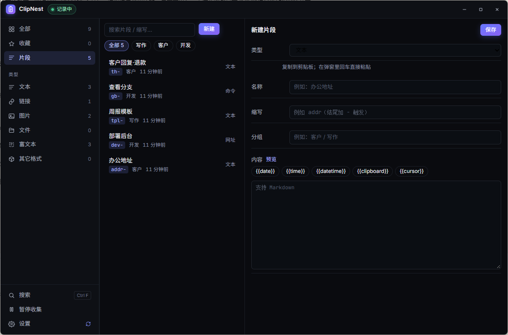

# 片段（短语库）

ClipNest 有两层内容：

| | 剪贴板历史 | 片段 |
| --- | --- | --- |
| 来源 | 自动采集（你复制什么就记什么） | 手写（你决定存什么） |
| 生命周期 | 按保留策略滚动淘汰 | 长期保留，直到你删除 |
| 用途 | 找回刚才复制过的东西 | 反复使用的回复、地址、提示词、命令 |
| 触发方式 | `Ctrl+Shift+V` → 搜索 | `--` 搜索，或在任意输入框敲**缩写** |


## 一、七种类型，各有各的动作

**缩写触发时，每种类型也各有动作**（不是只有文本能展开）：

| 类型 | 缩写触发时 |
| --- | --- |
| 文本 / 密码 / 网址 / 文件 | 把内容**打字**到光标处（文件类打出路径清单） |
| 图片 | 直接把图片**粘贴**过去（图片没有文本形态） |
| 命令 / 程序 | **执行**动作（命令在后台跑，输出只写日志，不污染输入框） |

| 类型 | Enter 做什么 | 说明 |
| --- | --- | --- |
| 文本 | 粘贴到光标处 | 支持 Markdown |
| 密码 | 粘贴到光标处 | 列表里掩码显示；**仍会同步**（私有 WebDAV 场景） |
| 图片 | 粘贴图片 | 从剪贴板抓一张即可 |
| 文件 | 复制文件到剪贴板 | 一行一个路径；**单个目录**则是「打开这个文件夹」 |
| 网址 | 用默认浏览器打开 | `Ctrl+Enter` 改为只复制链接 |
| 程序 | 启动程序 | 可带参数，例如 `code E:\default\clipnest` |
| 命令 | 执行 `cmd /c` | 返回首行输出，错误会显示在弹窗状态栏 |

`Ctrl+Enter` 一律是「只复制不粘贴 / 不执行」，和剪贴板历史的行为一致。

## 二、两种取用方式

**1. 弹窗里搜索（`--` 模式）**

`Ctrl+Shift+V` 打开弹窗 → 输入 `--` → 立即切换到片段模式，再输入关键词过滤：

- 匹配缩写（`addr`）、名称、正文、分组
- 缩写前缀命中的排在前面，所以敲 `ad` 就能看到 `addr-`
- `Enter` 执行、`Ctrl+Enter` 只复制、`1–9` 直选、`Esc` 关闭

**2. 缩写自动展开（打字即用）**

在设置 → 片段与缩写里打开「缩写自动展开」，然后：

```
你输入：  帮我把发票寄到 addr-            （addr 是缩写，- 是触发后缀）
结果：    帮我把发票寄到 杭州市滨江区 · ETool 科技园 A 座 1208
```

实现细节（为了「顺滑」和「不打断输入法」）：

- **不走剪贴板**：内容以 Unicode 按键（`KEYEVENTF_UNICODE`）逐字符注入，所以
  ① 目标程序不会闪一下「粘贴」，② **你的剪贴板内容不变**，③ 不会有粘贴后的选区残留。
  只有目标程序拒绝注入时才退回剪贴板粘贴（日志里会写明 `falling back to paste`）
- **退格批量化**：删掉已输入的缩写用**一次** `SendInput` 批次发出，不会出现逐字符回删的抖动`n- **尾部匹配**：缩写按「缓冲区末尾」匹配，前面打过什么字都不影响（只要 2 秒内、同一个窗口）；`n  空格/换行/切窗口/停顿都会清空缓冲，避免把别的窗口的字符带进来
- **完全不碰输入法**：不注入 `Win+Space`、不调用 `ImmSetOpenStatus/ImmSetConversionStatus`，
  输入法状态永远由你控制。检测到正在组词（`ImmGetCompositionString` 非空，或 IME 处于
  中文/日文/韩文直接输入模式）时**直接跳过**，把按键完整交还给 IME——所以中文输入时不会半路
  插入、也不会把拼音吃掉
- 只在**普通权限**的窗口生效：提权窗口（管理员身份的编辑器、任务管理器）受 UIPI 限制收不到
  模拟输入；部分游戏的全屏独占模式同样无效
- 有软件会误判键盘钩子（杀软/反作弊），所以默认**关闭**，需要你手动开
- 在 ClipNest 自己的窗口里不触发，避免自动补全时互相打断
- 自动化脚本（AutoHotkey/SendKeys）发出的按键标记为 injected，默认不会触发；调试时可设
  `CLIPNEST_EXPANDER_ALLOW_INJECTED=1` 放行

实测（`scratch/expand-target.ps1` 做的端到端靶子）：输入 `addr-` → 文本被替换成片段内容，
剪贴板保持原值；接着继续打字直接接在末尾；`cur-` → `ABCD` 且光标停在 AB 与 CD 之间，
再敲 `XY` 得到 `ABXYCD`。

## 三、模板变量与光标

文本类片段（文本 / 密码）在**执行时**才会替换下面这些占位符：

| 占位符 | 替换成 |
| --- | --- |
| `{{date}}` | `2026-11-17` |
| `{{date:long}}` | `2026年11月17日` |
| `{{time}}` | `17:30` |
| `{{datetime}}` | `2026-11-17 17:30` |
| `{{clipboard}}` | 当前剪贴板里的文本 |
| `{{cursor}}` | 不输出内容，**粘贴后光标停在这里** |

例如一个叫「会议记录」的片段：

```
## {{date}} 周会
参会：
结论：{{cursor}}
```

输入 `mtg-` 展开后，日期自动填上，光标停在「结论：」后面，可以直接打字。
实现上先粘贴整段，再按需要发 N 次 ←（N = 光标后面的字符数）。

编辑器里点一下 `{{date}}` 这类芯片就能把占位符插到内容末尾，「预览」按钮可切换 Markdown 渲染。



## 四、从历史一键存成片段

在剪贴板历史里选中一条 → 详情面板底部「**存为片段**」：文本/链接/图片/文件都会转成对应类型的片段
（分组默认 `来自历史`），之后在片段页配一个缩写即可长期复用。图片会连原始字节一起复制过去。

## 五、和同步的关系

片段与历史一起出现在同步包里（`clipnest_data/<deviceId>-<主机名>.zip`）：

```
package.json          items[] + snippets[] + deleted[] + deletedSnippets[] + settings
items/<hash>.json     历史记录正文
snippets/<hash>.json  片段正文
blobs/…               历史附件 + 片段图片
```

- 合并规则与历史一致：**按内容哈希**匹配（类型 + 缩写 + 正文），正文取更新时间新的那份，
  使用次数取大、收藏取或
- 删除用独立的墓碑（`deletedSnippets`）传播，删掉不会从别的机器回来
- 密码片段也同步——你的私有 WebDAV 场景下够用；**密码明文存在数据库与同步包里**，
  介意的话别把敏感内容存成密码片段

## 六、数据在哪

- `%APPDATA%\ClipNest\clipnest.db` 的 `snippets` / `snippet_blobs` 表
- 本地调试可以 `go run ./scratch/snippetseed` 塞几条示例片段
- 库文件里 `internal/clip/snippet.go`（模型与存储）、`snippet_actions.go`（动作与弹窗入口）、
  `snippet_expander_windows.go`（缩写钩子）
