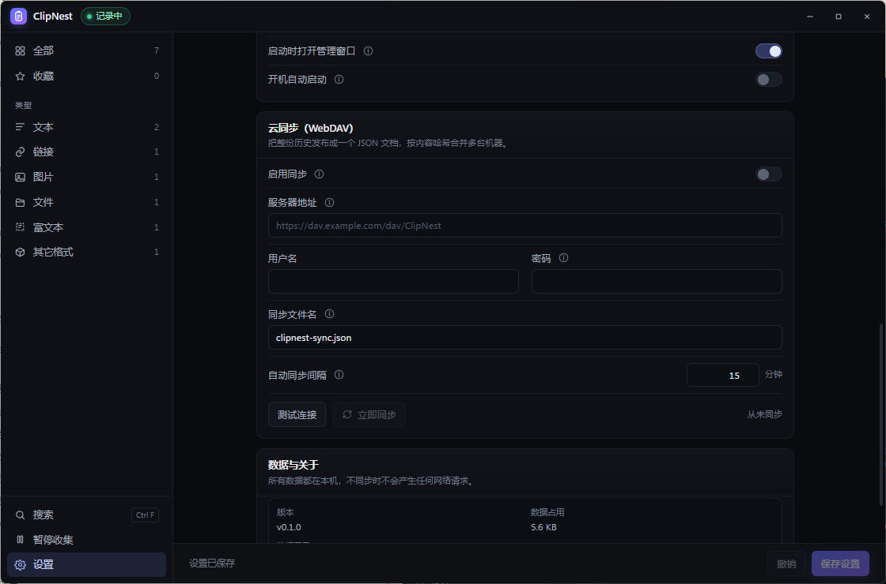

# WebDAV 跨机器同步

ClipNest 把整份历史发布成**一个 JSON 文档**放在你自己的 WebDAV 目录里，多台机器按内容合并。
不经过任何第三方服务，也不需要额外账号体系——用你已有的坚果云 / Nextcloud / Synology / Alist
等任意 WebDAV 即可。



## 一、怎么配

设置 → 云同步（WebDAV）：

| 字段 | 说明 |
| --- | --- |
| 启用同步 | 打开后启动 5 秒会跑一次，之后按间隔定时同步 |
| 服务器地址 | WebDAV **目录**，例如 `https://dav.jianguoyun.com/dav/ClipNest`（结尾的 `/` 可有可无） |
| 用户名 / 密码 | Basic Auth。密码明文保存在本机 `%APPDATA%\ClipNest\settings.json` |
| 同步文件名 | 目录里的文档名，默认 `clipnest-sync.json`；多台机器填一致 |
| 自动同步间隔 | 分钟，`0` 表示只在点「立即同步」时执行 |

按钮：**测试连接**（只 GET，不改动任何东西）、**立即同步**（拉取 + 合并 + 上传）。
状态行显示上次同步时间与结果；失败时红色显示原始错误（401 / 404 / TLS / 超时都会如实报）。

> 目录不存在时会自动尝试 `MKCOL` 创建上一级；部分服务禁止 MKCOL，需要先在网页端建好目录。

## 二、合并规则

匹配键是**内容哈希**（`Item.Hash`，与本地去重同一个键），因此同一段文字在两台机器上复制过
也只会有一条记录。对同一条记录：

| 字段 | 规则 |
| --- | --- |
| 正文、预览、HTML/RTF、文件列表、格式名、图片/字节 blob | 取 `UpdatedAt` 更新的一方 |
| `Pinned`（收藏） | **或**运算，任何一端收藏过就永远收藏 |
| `SeenCount` / `CopyCount` | 取较大值 |
| `CreatedAt` | 取较早值 |
| `ID` | 保留各自本地的 ID（不冲突，因为匹配靠哈希） |

合并后本地会按保留策略（最多条数 / 最长天数）再清理一次，收藏条目豁免。

图片与「其它格式」条目的原始字节以 base64 内嵌在文档里，单次同步总预算 6 MiB：超出预算的
blob 会被跳过（文档里 `truncated: true`），索引仍然同步。

## 三、实现要点

- 传输：`net/http` + Basic Auth 直接发 `GET` / `PUT` / `MKCOL`，不引入 WebDAV 客户端库。
- 文档：`{"version":1,"updatedAt":"…","device":"主机名","items":[…]}`，条目就是本地 `Item` 结构
  加一个可选 `blobB64`。
- 并发：同步内部有互斥，同一时刻只跑一次；间隔变更或开关切换会重启后台循环。
- 失败不影响本地：拉取失败照常用本地数据；上传失败只记错误，下次重试。
- 诊断：`%APPDATA%\ClipNest\clipnest.log` 里每次同步会写 `sync ok: 拉取 x 条新增 / y 条更新，已上传 z 条`。

## 四、已知限制

- **不做冲突合并**：同一条内容在两台机器被改成不同文本时，后写的（`UpdatedAt` 更晚）覆盖先写的。
- **删除不传播**：A 机器删掉的条目，下次同步会从 B 机器（或远端文档）再回来。要彻底删除，请在
  同步完成后于**所有**机器上删除，或清空远端文档。
- **密码明文落盘**：`settings.json` 里是明文；请使用 WebDAV 专用应用密码，不要用主账号密码。
  后续可接入 Windows DPAPI 加密。
- **文档大小**：历史越大文档越大（1000 条 + 图片时约几 MB），部分免费 WebDAV 有单文件大小限制。
- **仅同步 ClipNest 历史**，不含设置（每台机器的快捷键、忽略规则各自独立更合理）。

## 五、自己验证

仓库里带了一个一次性 WebDAV 服务器和自动化脚本：

```powershell
# 1) 起一个本地 WebDAV（服务 scratch\davroot 目录）
go run ./scratch/dav -addr 127.0.0.1:8899 -dir E:\default\clipnest\scratch\davroot

# 2) 在设置里把服务器地址填成 http://127.0.0.1:8899/ ，用户名密码留空
#    点「测试连接」→「立即同步」，然后看：
Get-Content "$env:APPDATA\ClipNest\clipnest.log" -Tail 5
Get-ChildItem E:\default\clipnest\scratch\davroot

# 3) 一键验证双向同步（会清空本地历史后重新拉取，注意备份）
go test ./internal/clip/ -run TestSync -v
```

`TestSyncUploadsAndPulls` / `TestSyncMergesByHashAndUnionsFlags` 用的是进程内 `httptest` +
`golang.org/x/net/webdav`，不需要外网。
